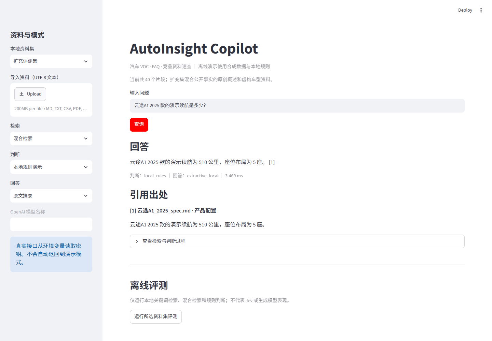
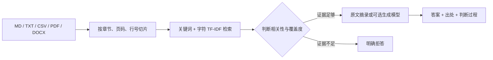

# AutoInsight Copilot

面向汽车 VOC、FAQ、产品与竞品资料的本地速查 MVP。输入问题后，系统检索资料片段，判断证据是否覆盖问题，输出原文摘录和文件/章节/页码。车型、竞品和反馈均为**合成演示数据**；扩充集另含依据公开事实重新撰写的电动车知识概述，不对应真实企业内部资料。



## 运行

需要 Python 3.10+。在 Windows PowerShell 中：

```powershell
py -3.12 -m venv .venv
.\.venv\Scripts\python.exe -m pip install -e ".[test]"
.\.venv\Scripts\python.exe -m pytest -q
.\.venv\Scripts\python.exe -m streamlit run app.py
```

打开终端显示的本地地址，默认是 `http://localhost:8501`。若 `py -3.12` 不存在，先安装 Python 3.12，或使用已安装的 3.10+ 解释器创建 `.venv`。

命令行查询与评测：

```powershell
.\.venv\Scripts\python.exe -m autoinsight.cli ask "星河X1标准版的演示续航是多少？"
.\.venv\Scripts\python.exe -m autoinsight.cli ask "星河X1的售价是多少？"
.\.venv\Scripts\python.exe -m autoinsight.cli evaluate
.\.venv\Scripts\python.exe -m autoinsight.cli evaluate --suite expanded
.\.venv\Scripts\python.exe -m autoinsight.stress
```

评测报告分别写入 `reports/generated/demo/` 与 `reports/generated/expanded/`；压力测试写入 `reports/generated/stress.json`。界面侧栏可切换两套资料并运行对应评测、下载 JSON。

## 工作方式



默认判断器是**本地规则演示**：它检查检索分数、车型/竞品名称及所问信息是否出现在片段中。规则可读、可复现，但不能理解所有同义表达，也不能证明资料真实。默认回答器直接摘录证据，不补写资料中没有的信息。界面的“查看检索与判断过程”可看到每个候选片段的分数和判断原因。

上传文档支持 Markdown、UTF-8 TXT/CSV、可提取文本的 PDF 和 DOCX；上传内容仅在当前进程中参与查询。图片型扫描 PDF 需要先做 OCR。Markdown 保留标题，CSV 保留行号，PDF 保留页码，DOCX 保留标题/段落或表格位置。长段落会再次切片。

## 可选真实接口

安装 Jev 可选依赖后，在界面中显式切换“真实 Jev”和/或“真实生成模型”。OpenAI 接口通过 Python 标准库调用官方 HTTP API，不需要额外 SDK：

```powershell
.\.venv\Scripts\python.exe -m pip install -e ".[jev]"
$env:TYPESAFE_API_KEY = "你的密钥"
$env:OPENAI_API_KEY = "你的密钥"
```

生成模型模式还需填写自己账号可用的模型名称。命令行示例：

```powershell
.\.venv\Scripts\python.exe -m autoinsight.cli ask "星河X1标准版的演示续航是多少？" --decision jev --generation openai --model "你的模型名称"
```

Jev 调用遵循 [TypeSafe Python SDK](https://github.com/typesafe-ai/typesafe-sdk-python) 的 `system_one` 接口，用两个独立的 Noul 问题判断相关性与证据覆盖度。生成调用遵循 [OpenAI Docs 的 Responses API](https://developers.openai.com/api/docs/guides/text)，并设置 `store=False`。API Key 只从环境变量读取；缺失密钥、响应异常或调用失败会明确报错，不会静默使用本地规则冒充真实接口。运行真实接口会产生实际调用费用；本仓库没有预设或声称任何 Jev 性能结论。

## 离线评测

`data/evaluation/questions.jsonl` 包含 50 条人工编写、基于合成资料的标注问题，覆盖直接查询、FAQ、VOC、竞品比较、跨文档组合、改写表达和资料缺失。评测比较三条路径：

| 方案 | 检索 | 判断 |
|---|---|---|
| `keyword` | 关键词 | 无过滤 |
| `hybrid` | 关键词 + TF-IDF | 无过滤 |
| `hybrid_local_rules` | 关键词 + TF-IDF | 本地规则 |

指标定义：召回@5 要求正确答案短语所在片段进入前五；回答准确率要求答案包含标注短语，缺失问题则要求拒答；出处正确率要求所引片段包含标注短语且来自预期文件；缺失问题拒答率只在不可回答问题上计算。延迟为本地进程内平均耗时，不含模型调用。成本字段在离线评测中为 `N/A`。

一次本地运行的结果如下；运行环境和缓存状态会影响延迟：

| 方案 | 召回@5 | 回答准确率 | 出处正确率 | 缺失问题拒答率 |
|---|---:|---:|---:|---:|
| 关键词 | 97.4% | 72.0% | 92.3% | 0.0% |
| 混合检索 | 100.0% | 74.0% | 94.9% | 0.0% |
| 混合检索 + 本地规则 | 100.0% | 98.0% | 97.4% | 100.0% |

这是一组小规模、同分布且由项目作者编写的合成题，不能外推到真实汽车业务，也不是 Jev 或 OpenAI 模型的测评。可查看生成的逐题 JSON 和失败样例，例如改写充电提问仍可能得到不完整证据。后续应使用获得授权并脱敏的实际资料做盲测，再确定阈值与上线策略。

## 扩充集与独立评测

`data/expanded/` 有 40 份可再发布的演示资料：12 份根据美国能源部 AFDC 公开页面的事实重新撰写的简短概述、28 份虚构车型资料。五种格式均有样本；`manifest.json` 逐份记录事实对应、来源 URL 和核验日期。公开来源只提供事实依据，不复制原网页全文；其中美国充电电压等知识**不适用于中国标准的直接推断**。重新生成固定数据：

```powershell
.\.venv\Scripts\python.exe scripts\build_expanded_corpus.py
.\.venv\Scripts\python.exe -m autoinsight.cli evaluate --suite demo
.\.venv\Scripts\python.exe -m autoinsight.cli evaluate --suite expanded
.\.venv\Scripts\python.exe -m autoinsight.stress
```

扩充集的 200 道题与原有 50 道分开计分，分为直接/FAQ 40、口语改写 30、车型/版本混淆 35、跨文档 25、VOC/竞品 20、证据缺失/错误前提 50。每道可答题有可接受答案组和精确到文件位置的必需证据。评测报告给出 Recall@5/@10、回答与出处正确率、缺失题拒答率、可答题误拒答率、按题型和文件格式的拆分及逐题结果。判分仍是自动字符串/出处匹配；30 道固定随机样本的作者核验见 `reports/expanded/audit.md`，不构成独立专家盲审。

本机一次离线运行结果（不同机器和缓存状态的延迟不可直接比较）：

| 资料集与方案 | 召回@5 | 回答正确率 | 出处正确率 | 缺失题拒答率 | 误拒答率 |
|---|---:|---:|---:|---:|---:|
| 原 50 题：混合 + 规则 | 100.0% | 98.0% | 97.4% | 100.0% | 2.6% |
| 新 200 题：关键词 | 98.7% | 66.0% | 88.0% | 0.0% | 0.0% |
| 新 200 题：混合 | 100.0% | 71.0% | 94.7% | 0.0% | 0.0% |
| 新 200 题：混合 + 规则 | 100.0% | 96.0% | 94.7% | 100.0% | 5.3% |

压力测试用固定种子生成无关及部分相似的干扰片段，30 次重复查询同一锚点；500 / 2,000 / 5,000 片段时，本机查询 p95 约为 14 / 39 / 131 ms。峰值内存只统计 Python `tracemalloc` 能追踪的分配，不是进程总 RSS；完整数据见 `reports/stress.json`。该测试检验索引规模对速度的影响，**不能证明大规模真实资料的检索质量**。

局限：新题由同一项目生成器编写，虽然与原 50 题分离，仍非外部独立盲测；单文件多为短事实，不能代表长篇真实手册、扫描 PDF 或复杂表格。规则和资料存在同分布优势，自动评分不等于语义理解。真实 Jev 与生成模型均未在本轮调用，未报告成本或性能。
新集尚有 8 道可答题被规则误拒答，主要集中在英文 PDF 充电时间和相近年款的手机功能问法；这比总体 96% 更值得作为下一轮改进目标。

## 项目结构

- `src/autoinsight/loaders.py`：资料读取、位置追踪和切片。
- `src/autoinsight/retrieval.py`：中文关键词与字符 TF-IDF 检索。
- `src/autoinsight/decisions.py`：本地规则与可选真实 Jev 判断。
- `src/autoinsight/generation.py`：原文摘录与可选生成模型。
- `src/autoinsight/evaluation.py`：批量评测和报告。
- `app.py`：Streamlit 界面；`data/demo/`：合成资料。

## 局限与公开边界

默认系统只能对本地资料做文本检索与摘录。规则分数不是“回答正确概率”；原文有错时答案也会有错。生成模型即使收到限制性指令，仍需由人核验引用和事实。上传真实资料前应确认使用权、保密要求和个人信息处理要求。仓库不包含真实客户反馈、内部项目文件或密钥。
